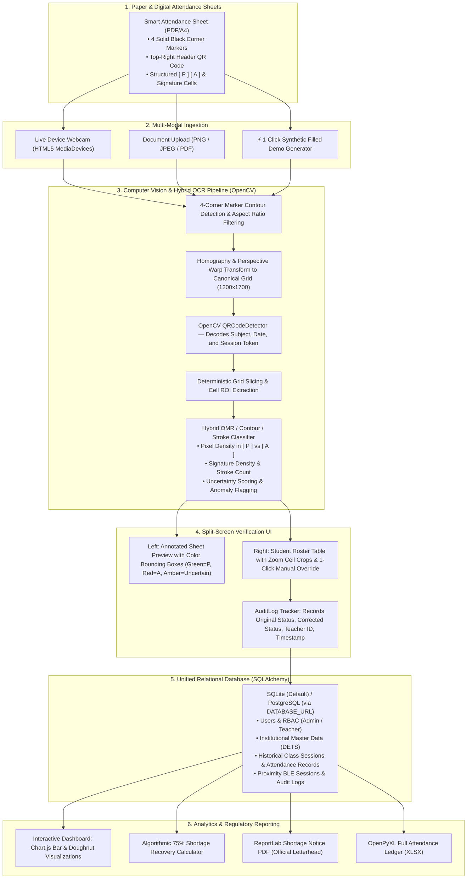

# AttendLens — Intelligent Student Attendance & Paper-to-Digital OCR System

> **Built for CoDETS Autumn Coding Challenge (Problem Statement 3: Smart Attendance Tracking & Paper-to-Digital OCR System)**  
> **Institution:** Department of Engineering & Technological Studies (DETS)  
> **License:** 100% Free & Open-Source Software (MIT, Apache-2.0, BSD-3-Clause, PSF)  
> **Privacy:** 100% On-Premise / Local execution with synthetic anonymized university records. Zero proprietary APIs, zero closed-source cloud OCR vision services, zero paid SDKs.

---

## 🏛️ System Architecture Diagram



---

## 📜 Open-Source SPDX License Attribution Table

Every component, library, and framework used in AttendLens is licensed under permissive, OSI-approved open-source licenses:

| Component / Library | Version | SPDX License | Purpose & Architectural Justification |
| :--- | :--- | :--- | :--- |
| **FastAPI** | `0.110.0+` | [MIT](https://spdx.org/licenses/MIT.html) | Asynchronous high-performance REST API routing & validation |
| **Uvicorn** | `0.28.0+` | [BSD-3-Clause](https://spdx.org/licenses/BSD-3-Clause.html) | High-speed ASGI production server |
| **SQLAlchemy** | `2.0.0+` | [MIT](https://spdx.org/licenses/MIT.html) | Database ORM supporting SQLite and PostgreSQL via `DATABASE_URL` |
| **OpenCV (`opencv-python-headless`)** | `4.9.0+` | [Apache-2.0](https://spdx.org/licenses/Apache-2.0.html) | Perspective transformation, 4-corner marker detection, QR decoding, cell segmentation |
| **ReportLab** | `4.1.0+` | [BSD-3-Clause](https://spdx.org/licenses/BSD-3-Clause.html) | Vector PDF generation for smart fiducial sheets and official shortage notices |
| **Pillow (PIL Fork)** | `10.2.0+` | [HPND](https://spdx.org/licenses/HPND.html) | Synthetic handwriting rendering, image decoding, base64 thumbnail generation |
| **qrcode** | `7.4.2+` | [BSD-3-Clause](https://spdx.org/licenses/BSD-3-Clause.html) | Matrix 2D barcode generation for sheet metadata encoding |
| **OpenPyXL** | `3.1.2+` | [MIT](https://spdx.org/licenses/MIT.html) | Spreadsheet generation for attendance templates and multi-session ledgers |
| **Authlib & Cryptography** | `1.3.0+ / 42.0+` | [BSD-3-Clause / Apache-2.0](https://spdx.org/licenses/Apache-2.0.html) | Google OAuth2 SSO client and password hashing |
| **Tailwind CSS (CDN)** | `3.4+` | [MIT](https://spdx.org/licenses/MIT.html) | Academic dashboard aesthetic, responsive layouts, color schemes |
| **Chart.js (CDN)** | `4.4+` | [MIT](https://spdx.org/licenses/MIT.html) | Interactive attendance rate bar charts and threshold distribution doughnuts |
| **Lucide Icons (CDN)** | `0.344+` | [ISC](https://spdx.org/licenses/ISC.html) | Accessible user interface iconography |

---

## ⚡ Quickstart Guide (Single Command Execution)

### 1. Clone & Navigate
```bash
git clone https://github.com/dets-hackathon/AttendLens.git
cd AttendLens
```

### 2. Install Dependencies
```bash
pip install -r requirements.txt
```

### 3. Run Application
```bash
# Double click run.bat or run:
run.bat

# Or from PowerShell / CMD inside the project folder:
cd C:\ide_project\DETS
py main.py

# Or using Uvicorn directly:
uvicorn main:app --reload --host 0.0.0.0 --port 8000
```
- Open Admin & Teacher Dashboard at: **`http://localhost:8000`**
- Open Dedicated Mobile Student Portal at: **`http://localhost:8000/student`**
- Connect Mobile Phones over LAN / Hotspot: Scan the QR code shown in the teacher's **"Hands-Free BLE Check-In"** tab or visit `http://<your-lan-ip>:8000/student`.

---

## 🔑 Pre-Seeded Accounts for Hackathon Judges

AttendLens comes pre-seeded with synthetic institutional data, 20 anonymized student profiles (`DETS-26-EIE-001` to `DETS-26-EIE-020`), 3 courses, and 12 historical sessions.

| Role | Pre-Seeded Email | Password | 1-Click Evaluation |
| :--- | :--- | :--- | :--- |
| **Administrator (Dean)** | `admin@dets.edu` | `Admin@123` | Select **"Prof. Banerjee (Admin)"** in top-right dropdown |
| **Teacher (Instructor)** | `prof.sharma@dets.edu` | `Teacher@123` | Select **"Dr. Sharma (Teacher)"** in top-right dropdown |

---

## 🎯 Core Functional Modules

### 1. Authentication & Role-Based Access Control (RBAC)
- **1-Click Quick Role Switcher:** Hackathon judges can instantly switch between Admin and Teacher roles without re-typing passwords.
- **Google OAuth2 SSO:** Configurable via `.env` or the Admin Settings tab (`GOOGLE_CLIENT_ID` & `GOOGLE_CLIENT_SECRET`).
- **Granular Permissions:** Admins manage master institutional metadata, global thresholds, and external API webhooks. Teachers manage sheet generation, vision scanning, split-screen manual review, BLE sessions, and reports.

### 2. Configurable Master Data Engine (Admin Tab)
- Configure Institution Name, Code, Academic Year, Semester, and Minimum Attendance Threshold slider (default 75%).
- **Bulk Ingestion:** Drag-and-drop CSV or JSON files to bulk-upload students or subjects.
- **External Services Configuration:** Modular fields for Google SSO, Cloud Storage archive paths (`s3://...`), and Institutional ERP webhooks.

### 3. Printable Attendance Sheet Generator (Teacher Tab)
- Filter by Subject, Date, Academic Year, and Semester.
- **Smart PDF Sheet:** Automatically renders 4 solid black alignment fiducial squares at the corners, top-right header QR code encoding `subject_code|date|session_token`, and standardized student rows with `[ P ] [ A ]` target boxes and signature baselines.
- **Formatted XLSX Sheet:** Excel attendance template with institutional formatting.

### 4. Sheet Upload, Hybrid OCR & Split-Screen Verification
- **Multiple Ingestion Modes:** Local PNG/JPEG/PDF upload, live webcam snap (`getUserMedia`), mobile rear camera capture (`capture="environment"`), or the **1-Click "⚡ Generate Sample Filled Sheet Image"** button.
- **OpenCV Vision Engine:**
  - Detects corner fiducials and applies perspective deskewing to a canonical $1200 \times 1700$ grid.
  - Decodes header QR code to auto-populate class metadata.
  - Slices student cells, analyzes pixel density in P vs A target boxes, and analyzes signature stroke density.
  - Computes confidence scores ($0\text{--}100\%$) and flags rows with ambiguous or conflicting marks as `UNCERTAIN`.
- **Split-Screen Verification UI:**
  - Left: Processed sheet preview with color bounding boxes (Green = Present, Red = Absent, Amber = Uncertain).
  - Right: Interactive table displaying student details, zoomed-in cell crops, OCR confidence badges, and 1-click override buttons (`[P]` / `[A]`).
  - Commits verified records and logs every manual override into an `AuditLog` database table.

### 5. Hands-Free BLE / Proximity Digital Check-In & Live Mobile Stream
- Teacher initiates a 2-minute proximity check-in window generating a rotating 4-digit PIN code and session token.
- **Live Student Mobile Connect:** Auto-detects host machine's LAN IP, renders scannable QR code on the teacher dashboard, supports custom HTTPS tunnel URLs, and streams live student check-ins every 3 seconds.

### 6. Mobile Student Portal & Course Self-Enrollment (`/student`)
- **Proximity Check-In:** Dedicated mobile UI where students enter the active 4-digit session PIN to mark attendance and immediately receive a green digital attendance receipt with their updated attendance percentage.
- **Course Self-Enrollment:** Enables any student to enroll with their personal details (Full Name, Roll Number, Email, Department, and Semester) into any active class or subject (`POST /api/student/enroll`), immediately adding them to the institutional roster and printable sheets.
- **Installable Progressive Web App (PWA):** Equipped with `manifest.json`, offline service worker caching (`sw.js`), and desktop/mobile "Install App" support.

### 7. Attendance Analytics & Shortage Reports
- **Real-Time KPIs:** Classes Held, Enrolled Students, Average Attendance Rate, and Shortage Defaulters count.
- **Visualizations:** Chart.js Bar Chart for subject comparison and Doughnut Chart for threshold distribution.
- **75% Recovery Calculator:** Evaluates the exact formula:
  $$\text{Classes Needed} = \max\left(0, \left\lceil \frac{0.75 \times \text{Held} - \text{Attended}}{0.25} \right\rceil\right)$$
- **One-Click Export:**
  - **Shortage Notice (PDF):** Official institutional letterhead report listing debarred students, shortage gap, recovery classes required, and Dean/HOD signature blocks.
  - **Full Ledger (XLSX):** Multi-session spreadsheet with per-class dates, aggregate attendance %, and color-coded status badges.

---

## 🔒 Privacy & Data Anonymization Statement

In compliance with strict data protection guidelines:
1. **Synthetic Data Only:** All names, roll numbers (`DETS-26-EIE-001` through `020`), and email addresses are entirely fictitious.
2. **Local Processing:** All OpenCV computer vision algorithms, QR decoding, and database transactions execute locally on the host machine. No biometric or facial recognition data is captured or transmitted.

---

*AttendLens — Engineered for Department of Engineering & Technological Studies (DETS)*
